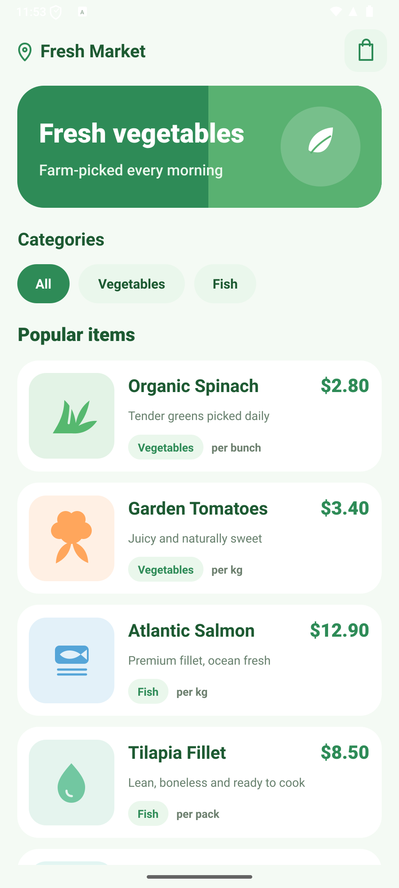

# Leaf & Tide

A Flutter MVP product catalog for fresh vegetables and fish. The app uses a clean green-and-white theme, a custom splash screen, and a scrollable catalog with product categories, descriptions, and prices.

## Design



The SVG is a screen-matched concept for the catalog UI in `lib/main.dart`.

## Features

- Custom branded splash screen
- Catalog of vegetable and fish products
- Clear prices and units for each product
- Green-and-white visual theme
- Flutter project targeting Android and iOS

## Run the app

Install Flutter, then run:

```sh
flutter pub get
flutter run
```

## Build Android release APK

```sh
flutter build apk --release
```

The APK is written to `build/app/outputs/flutter-apk/app-release.apk`.

## Tests

```sh
flutter analyze
flutter test
```
